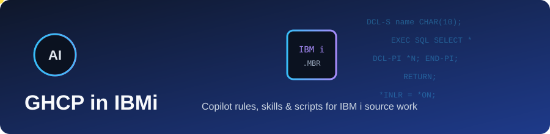
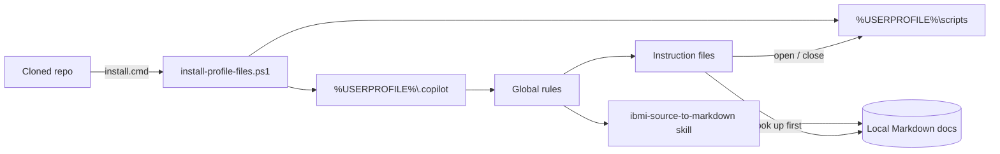
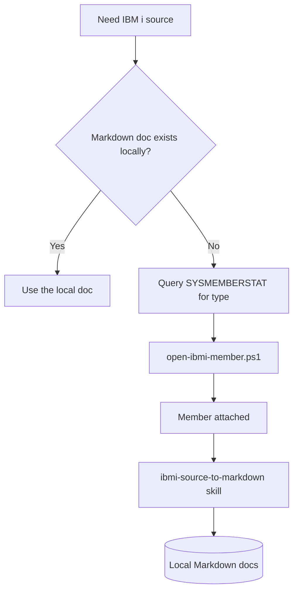

# GHCP in IBMi

<p align="center">
  
</p>

<p align="center">
  
  
  
  
</p>

Shared GitHub Copilot configuration for working with IBM i source in VS Code (using the Code for IBM i extension). It provides global Copilot rules, task-specific instructions, skills, and helper scripts, plus an installer that copies them into each user's profile.

## ⚡ Quick start

1. Clone the repository using one of the methods below.
2. Double-click `install.cmd`.
3. Restart VS Code so Copilot picks up the installed files.

## Getting the code

The simplest option is HTTPS, using Git from PowerShell or a terminal:

```powershell
git clone https://github.com/GHCP-in-IBMi/GHCP-in-IBMi.git
```

If you have [GitHub CLI](https://cli.github.com/) installed and authenticated,
you can clone it with:

```powershell
gh repo clone GHCP-in-IBMi/GHCP-in-IBMi
```

SSH and GitHub Desktop are also options if you already use them. Prefer a Git
clone over **Download ZIP** if you want to get future updates: ZIP downloads
are source snapshots without Git history or a remote to pull from.

To update an existing clone and reinstall the latest profile files:

```powershell
git pull
.\install.cmd
```

## 🗺️ How it fits together



### Source lookup flow



## What's in this repository

| Path | Purpose |
|------|---------|
| `install.cmd` | Double-click launcher that runs the PowerShell installer. |
| `scripts\install-profile-files.ps1` | Copies `.copilot` and `scripts` into `%USERPROFILE%`. |
| `scripts\open-ibmi-member.ps1` | Opens an IBM i source member in the current VS Code window. |
| `scripts\close-vscode-tab.ps1` | Closes a VS Code tab whose name matches a given string, activating it first if needed. |
| `.copilot\copilot-instructions.md` | Global rules applied to all Copilot sessions, agents, and subagents. |
| `.copilot\instructions\` | Task-specific instruction files referenced by the global rules. |
| `.copilot\skills\ibmi-source-to-markdown\SKILL.md` | Skill that converts an attached IBM i source snapshot to Markdown. |

### Global rules (`copilot-instructions.md`)

Copilot is treated as an IBM i expert and told to avoid over-engineering, avoid guessing, give no preamble/postamble, and never hardcode absolute paths. Key rules:

- All IBM i SQL must go through the `vscode-db2i-chat-sqlRunnerTool`, but SQL must never be used to read or analyze member source.
- Whenever an IBM i program, member, or source is attached, the `ibmi-source-to-markdown` skill is invoked first.
- Read-only snapshots of members are used only inside that conversion workflow.
- Specific tasks are delegated to the instruction files below.

### Instruction files (`.copilot\instructions\`)

| File | Used for |
|------|----------|
| `ibmi-source-lookup.instructions.md` | Looking up source: check the local Markdown documentation first; if missing, fall back to opening the member rather than searching the system. |
| `ibmi-member-opening.instructions.md` | Opening a member: look up its type in `QSYS2.SYSMEMBERSTAT`, then use only `open-ibmi-member.ps1`. |
| `vscode-tab-closing.instructions.md` | Closing a tab: use only `close-vscode-tab.ps1` with a distinctive title match. |
| `ibmi-source-scanning.instructions.md` | Reading/scanning members as rows with `QSYS2.IFS_READ` (required parameters, forbidden variants, DDS column layout). |
| `ibmi-kb-update.instructions.md` | Checking and updating the local `ibmi-second-brain` knowledge base with verified facts. |

### Skill: `ibmi-source-to-markdown`

Converts an attached IBM i source snapshot (RPGLE, SQLRPGLE, CLLE, CLP, DDS, PF, LF, DSPF, PRTF, SQL, COBOL) into `<SRCF>\<MBR>.<TYPE>.md` in the local IBM i documentation folder. The output keeps the original source lines in order, with blank lines and comment-only lines removed. The workflow then reads the file back, validates it line for line, and requires an independent review before reporting success.

### Scripts

- **`open-ibmi-member.ps1`** — Accepts `LIB/SRCF/MBR[.TYPE]` or `-Library`, `-SourceFile`, `-Member`, with optional `-Type`. Opens a `member:` URI via `code --reuse-window` and waits up to 30 seconds for the matching editor window title.
- **`close-vscode-tab.ps1`** — Requires `-Match`. Brings the VS Code window to the foreground. If the matching tab is not active, it activates it through Quick Open (Ctrl+P). It sends Ctrl+W only after the window title confirms the matching tab is active, then checks that the title changed. Exit codes:

  | Code | Meaning |
  |------|---------|
  | 0 | Tab closed. |
  | 1 | No VS Code window found. |
  | 2 | Could not bring VS Code to the foreground. |
  | 3 | Tab did not close (it may have a save prompt). |
  | 4 | Could not activate a tab matching `-Match`. |
  | 5 | Active tab changed after focusing the editor; nothing closed. |

## Installation

After cloning the repository, double-click `install.cmd` in File Explorer. It launches the PowerShell installer and keeps the window open if installation fails so the error remains visible.

Alternatively, run the installer from the repository root in PowerShell:

```powershell
.\scripts\install-profile-files.ps1
```

The installer copies the contents of the repository's `.copilot` and `scripts` directories, including hidden files and subfolders, to `%USERPROFILE%\.copilot` and `%USERPROFILE%\scripts`. Matching files at those destinations are overwritten; other local files are left untouched.

To preview the copies without changing files, run:

```powershell
.\scripts\install-profile-files.ps1 -WhatIf
```

Git does not execute repository scripts as part of cloning. Run the installer after cloning, and again whenever you want to update the installed files.

## Requirements

- Windows with PowerShell and VS Code (`code` on the PATH).
- The Code for IBM i extension and the `vscode-db2i-chat-sqlRunnerTool` (an active SQL job) for the IBM i workflows.
- Local IBM i documentation and knowledge-base folders, as referenced by the instruction files and skill.
